`zek@zek-debian:~$ whoami`

### Ezekiel Baniaga

☕ Java · 🍃 Spring Boot · 🐘 PostgreSQL · ⚡ Zig · ⚙️ C · 🔩 C++ · 🐍 Python · 🟢 Node · ✴️ the Claude API

 

  

  

  

## AI News

- Anthropic's revised S-1/A filing warns that its growing use of AI in its own R&D could soon meet its Responsible Scaling Policy threshold for "dramatically accelerated progress," though no current model has crossed it ([TechCrunch](https://techcrunch.com/2026/11/02/anthropic-warns-that-its-very-close-to-rsi-capability-aka-self-building-ai/)).
- MIT researchers used OpenAI's GPT-6 Astra to directly edit a small open-weights Qwen model, lifting its MATH-500 score from 7.9% to 48.1% by touching about 0.016% of its weights ([VentureBeat](https://venturebeat.com/technology/like-gene-editing-for-neural-networks-mit-researchers-used-gpt-6-astra-to-edit-qwens-open-weights-directly-boosting-math-performance)).
- The New York Times and other outlets sued the privacy-focused Brave browser on Monday, alleging it scraped their copyrighted content ([TechCrunch](https://techcrunch.com/2026/11/02/new-york-times-and-other-outlets-sue-web-browser-brave-over-alleged-content-scraping)).
