`zek@zek-debian:~$ whoami`

### Ezekiel Baniaga

☕ Java · 🍃 Spring Boot · 🐘 PostgreSQL · ⚡ Zig · ⚙️ C · 🔩 C++ · 🐍 Python · 🟢 Node · ✴️ the Claude API

 

  

  

  

## AI News

- Elon Musk and other tech executives signed a petition, which topped 115,000 signatures, calling on Nvidia's board to reinstate Jensen Huang as CEO ([Source](https://techcrunch.com/2026/11/14/elon-musk-other-tech-execs-sign-petition-calling-on-nvidia-to-reinstate-jensen-huang/))
- Governments in Japan, South Korea, Taiwan and Singapore moved to shore up chip supply commitments after Jensen Huang's exit, with Nvidia reportedly reaffirming plans to supply South Korea with 260,000 advanced GPUs ([Source](https://techcrunch.com/2026/11/14/asian-governments-react-to-nvidia-ceo-jensen-huangs-exit/))
- VCs and founders say Jensen Huang's departure leaves a big hole in AI startup funding, with founders bracing for smaller checks from Nvidia ([Source](https://techcrunch.com/2026/11/13/jensen-huangs-departure-blasts-big-hole-in-ai-startup-funding-vcs-and-founders-say/))
