`zek@zek-debian:~$ whoami`

### Ezekiel Baniaga

☕ Java · 🍃 Spring Boot · 🐘 PostgreSQL · ⚡ Zig · ⚙️ C · 🔩 C++ · 🐍 Python · 🟢 Node · ✴️ the Claude API

 

  

  

  

## AI News

- OpenAI chief scientist Jakub Pachocki floated using perplexity as a measurable "speed limit" for pacing AI development ([Source](https://techcrunch.com/2026/11/22/openais-chief-scientist-has-thoughts-on-how-to-limit-ai-development/))
- Notable Capital, GIC and Baillie Gifford placed big early bets on Anthropic ahead of its record-setting IPO at a roughly $1.5 trillion valuation ([Source](https://techcrunch.com/2026/11/22/how-notable-capital-gic-and-baillie-gifford-bet-big-on-anthropic-before-its-ipo))
- OpenAI will embed outside safety researchers from groups like Apollo Research and METR inside the company to investigate AI subversion risks ([Source](https://techcrunch.com/2026/11/16/openai-will-embed-apollo-researchers-to-investigate-ai-subversion/))
