`zek@zek-debian:~$ whoami`

### Ezekiel Baniaga

☕ Java · 🍃 Spring Boot · 🐘 PostgreSQL · ⚡ Zig · ⚙️ C · 🔩 C++ · 🐍 Python · 🟢 Node · ✴️ the Claude API

 

  

  

  

## AI News

- Anthropic has filed for its public debut under the ticker "ANT", reporting $16.3 billion in revenue for the first half of 2026 ([TechCrunch](https://techcrunch.com/2026/10/26/anthropic-officially-files-for-its-public-debut)).
- OpenAI says it will stop training its models on the live internet, citing significant risks, and will use cached and simulated copies of the web instead ([TechCrunch](https://techcrunch.com/2026/10/23/openai-says-it-will-no-longer-train-its-ai-models-on-the-live-internet-citing-significant-risks/)).
- Canva has released its first image generation model, Canva Craft, entering a field that includes Google, OpenAI, ByteDance and Meta ([TechCrunch](https://techcrunch.com/2026/10/22/canva-releases-its-first-image-generation-model)).
