`zek@zek-debian:~$ whoami`

### Ezekiel Baniaga

☕ Java · 🍃 Spring Boot · 🐘 PostgreSQL · ⚡ Zig · ⚙️ C · 🔩 C++ · 🐍 Python · 🟢 Node · ✴️ the Claude API

 

  

  

  

## AI News

- Isomorphic Labs raised a $5 billion Series C to push its AI-designed drug candidates toward clinical trials after positive preclinical results in oncology and immunology ([Source](https://techcrunch.com/2026/11/17/isomorphic-labs-raises-5b-as-it-looks-to-take-drug-candidates-to-clinical-trials/))
- Alibaba launched its proprietary Qwen4-Max model, which cut average task costs in internal evaluations from $4.43 to $1.67 but still trails frontier rivals on independent benchmarks ([Source](https://venturebeat.com/technology/alibabas-qwen4-max-cuts-ai-task-costs-but-benchmarks-show-an-uneven-challenge-to-frontier-rivals))
- Amazon warned that attackers are using stolen AI API keys to power autonomous agents that hunt for more exposed credentials ([Source](https://venturebeat.com/security/amazon-says-hackers-are-using-stolen-ai-api-keys-to-power-agents-that-hunt-for-more))
